# ST Manager

> 面向 SillyTavern 创作者的本地资源工作台：集中管理角色卡、世界书、聊天记录、预设、扩展脚本和视觉主题。

<p align="center">
  
</p>

<p align="center">
  <a href="https://www.python.org/"></a>
  <a href="https://flask.palletsprojects.com/"></a>
  <a href="https://www.sqlite.org/"></a>
  <a href="LICENSE"></a>
</p>

## 项目定位

ST Manager 是一个以本地文件为主、SQLite 元数据为辅的 SillyTavern 资源管理器。它适合需要长期维护大量角色卡、世界书、聊天、预设和扩展资源的个人创作者工作流。

项目提供统一的浏览、搜索、筛选、编辑、预览、导入、导出、同步和恢复入口。资源仍然保存在本地目录中，管理器只负责建立索引、维护界面数据和提供工作台能力。

除内置功能外，管理器还支持插件扩展：插件可以向宿主界面投放入口或自绘界面，也可以提供后端能力，无需改动主程序。

## 功能总览

<table>
  <tr>
    <td valign="top" width="33%">
      
      <strong>角色卡库</strong><br>
      PNG/JSON 卡片、内嵌世界书、聚合包、版本封面、资源皮肤、收藏、标签、批量操作和来源更新监控。
    </td>
    <td valign="top" width="33%">
      
      <strong>世界书工作台</strong><br>
      全局、资源绑定和角色卡内嵌世界书统一浏览，支持预览、编辑、历史、剪贴板、导出和发送到 ST。
    </td>
    <td valign="top" width="33%">
      
      <strong>聊天记录</strong><br>
      JSONL 聊天导入、元数据、角色卡绑定、全文搜索、范围加载、书签、楼层定位和沉浸式阅读。
    </td>
  </tr>
  <tr>
    <td valign="top">
      
      <strong>预设浏览与编辑</strong><br>
      OpenAI 兼容预设、提示词序列、采样参数、扩展脚本、版本合并、快照、差异和 ST 同步。
    </td>
    <td valign="top">
      
      <strong>Beautify 美化包</strong><br>
      主题包、变体、设置、壁纸、头像、截图和隔离预览，支持将主题发送到 SillyTavern。
    </td>
    <td valign="top">
      
      <strong>扩展、自动化与系统</strong><br>
      Regex/ST Helper、高级规则、文件监听、索引、快照、回收站、路径安全和 SillyTavern 连接。
    </td>
  </tr>
  <tr>
    <td valign="top">
      
      <strong>插件系统</strong><br>
      官方目录一键安装、手动上传 zip 或从 GitHub 仓库安装；插件可声明菜单、插槽、命令与自绘界面，并提供配置、密钥、作业面板与文档预览。
    </td>
    <td valign="top">
      
      <strong>抽卡开包</strong><br>
      用「手气不错」的骰子按钮单抽开包或十连翻牌，稀有度由收藏与 Token 分档派生，揭晓卡可直接进入详情页。
    </td>
    <td valign="top">
      
      <strong>命令面板与插件入口</strong><br>
      <code>Ctrl/Cmd + K</code> 打开命令面板；插件入口会出现在右键菜单、批量菜单、顶部动作区、入口坞与设置导航中。
    </td>
  </tr>
</table>

## 插件系统

插件是一个放在 `data/plugins/<插件 id>/` 下的标准包，安装后可向宿主界面投放入口，或直接自绘自己的界面。

- **两种界面模式**：`declarative`（默认）声明菜单、插槽与命令，由宿主渲染；`custom` 通过 `api.createRoot` 自绘。
- **贡献落点**：文件夹/卡片/页脚右键菜单、批量操作菜单、命令面板、顶部动作区、右侧入口坞、设置页导航，以及卡片详情页签、各页工具条、空状态等插槽。
- **安装方式**：官方目录一键安装（带 sha256 校验）、GitHub 仓库（可指定分支/标签与子目录）、本地 zip 上传。
- **运行能力**：可写后端 Python，提供配置 schema（自动生成表单）、密钥存储、后台作业与 SSE 进度、逐条审批、插件文档预览。
- **隔离与兜底**：单个插件加载失败不影响其它插件与宿主；反复出错的插件会被标记降级；浮层关不掉时可用「关闭所有插件浮层」一键回收。

插件开发者入口：

| 资源 | 说明 |
| --- | --- |
| [插件 API 参考](docs/plugin-api.md) | 由代码生成的完整 API 参考，不要手工编辑 |
| [清单 schema](docs/plugin-manifest.schema.json) / [类型定义](docs/plugin-api.d.ts) | `manifest.json` 的 JSON Schema 与 TypeScript 类型，可直接用于编辑器补全 |
| [v2 → v3 迁移指南](docs/plugin-migration-v2-to-v3.md) | 旧契约升级到 v3 的对照说明 |
| `tools/new_plugin.py` | 生成符合规范的插件骨架 |
| `tools/stm_plugin_check.py` | 独立严格校验器，第三方插件仓库可直接接入 CI |

## 界面展示

桌面端和移动端使用同一套资源模型与 API。移动端不是另一套功能，而是针对窄屏重新组织导航、工具栏、详情面板和阅读区域。

### PC 端

下面的截图按用户实际使用流程排列：先找到资源，再打开详情或编辑器，然后是同步、自动化、插件与系统设置。

#### 1. 工作区总览与资源导航

<p align="center">
  
</p>

顶部工具栏承载工作区切换、导入、批量动作、收藏、搜索、排序、主题和系统入口；左侧导航显示资源文件夹、分类计数和标签索引，主区域负责卡片或条目展示。

#### 2. 角色卡列表

<p align="center">
  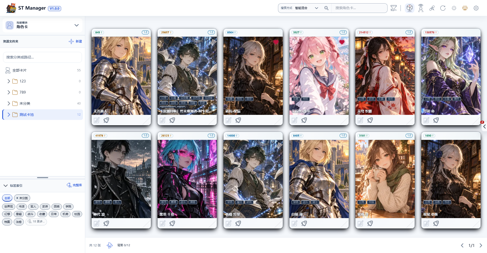
</p>

- 支持 PNG/JSON 角色卡和角色卡内嵌数据。
- 支持文件夹、递归分类、收藏置顶、分页、排序和随机卡片。
- 支持从 URL 导入、批量导入、卡片移动、删除到回收站和资源目录检查。
- 卡片网格会显示 Token、版本/聚合包状态、标签和快捷操作。
- 顶部骰子按钮在角色卡视图下改为抽卡：单抽开包或十连翻牌，详见第 18 节。

#### 3. 角色卡详情页与编辑工作台

<p align="center">
  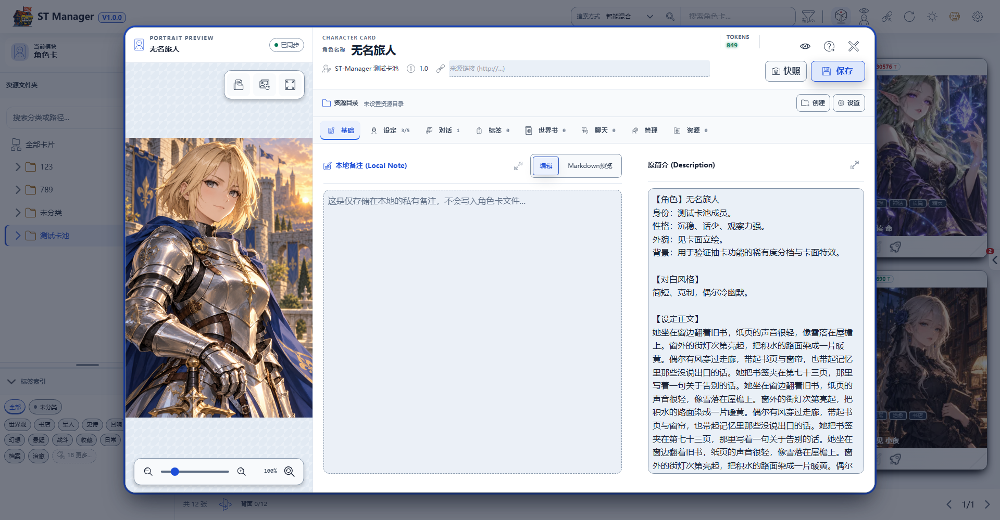
</p>

详情工作台将卡片内容拆成多个面板，包含基础信息、对话/开场白、标签、世界书、聊天、管理和资源等区域。可以编辑本地备注、描述和元数据，切换卡片图片或皮肤，管理内嵌世界书与聊天，并通过保存、快照和版本封面保护修改结果。

- 覆盖更新时可以勾选「覆盖时保留已有创作者」，避免上传文件把本地维护的作者信息顶掉。
- 资源目录条支持在「浏览」「设置」之间「改名」，改名会连带迁移绑定、世界书备注、条目历史与索引归属。
- 换图、换封或覆盖更新后，修订号会自动同步，不再出现保存时被乐观锁拒绝的 409。

#### 4. 搜索、筛选与标签工作台

<p align="center">
  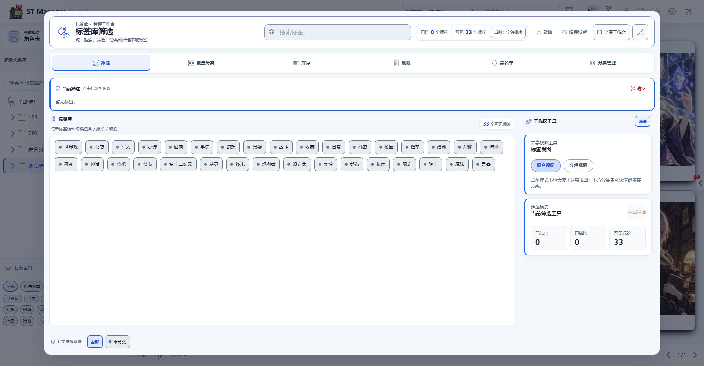
</p>

<p align="center">
  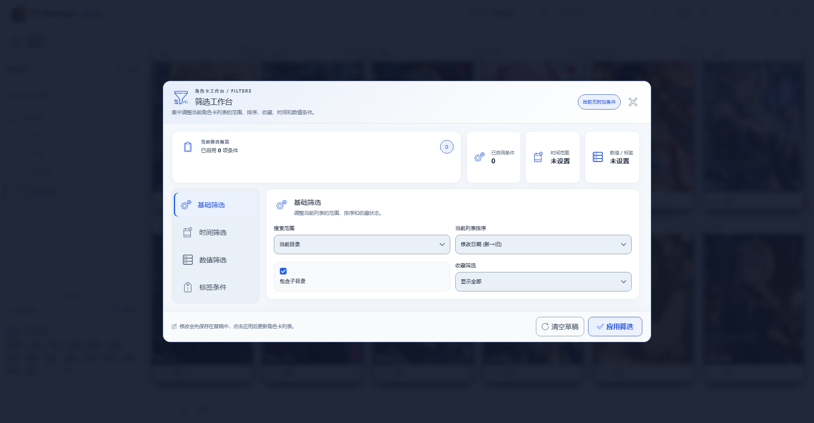
</p>

- 支持混合搜索、名称、文件名、标签和创建者搜索。
- 支持快速索引搜索与全文搜索，以及当前目录、所有目录和完整范围。
- 支持包含标签、排除标签、收藏过滤、Token 范围和导入/修改日期范围。
- 标签工作台支持标签顺序、分类、颜色、隔离分类、批量增删和合并预览。
- 世界书视图另有「搜索分类」（智能 / 世界书名 / 文件名 / 所属角色卡），详见第 5 节。

#### 5. 世界书浏览

<p align="center">
  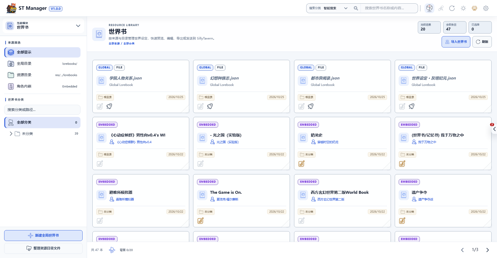
</p>

世界书列表区分全局目录、角色卡资源目录和角色卡内嵌世界书。可以按来源、分类、递归目录、名称和内容筛选，查看条目数量、来源路径、修改时间，并直接进入详情或编辑器。

- 搜索可选范围：智能、世界书名、文件名、所属角色卡；后三项直接查索引列，比全文检索更快。
- 中文全文搜索已可用（逐字切分 + 短语匹配），两字关键词也能命中，大库下从约 10 秒降到毫秒级。
- 搜索词含标点或语法错误时返回空结果并提示，不再报错。

#### 6. 世界书编辑器与阅览

<p align="center">
  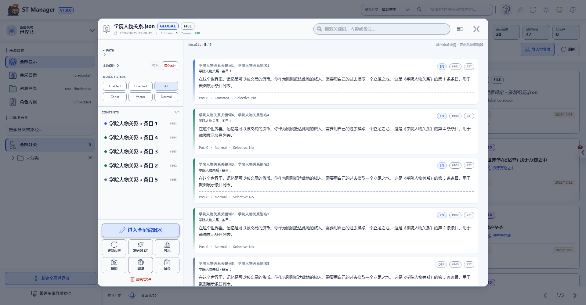
</p>

- 编辑条目备注、关键词、内容、策略、插入位置、顺序和递归设置。
- 管理启用状态、概率、Token 计数、深度和高级逻辑。
- 支持条目搜索、预览、历史版本、剪贴板、重排和批量处理。
- 独立世界书可以保存、导出、迁移和发送到 SillyTavern；内嵌世界书保留与角色卡的绑定关系。
- 详情页底部新增「更新内容」：从本地文件或 HTTP/HTTPS 地址取回新版本，先看红绿条目差异，确认后整本替换并自动备份，可从「回滚」恢复。

#### 7. 聊天记录管理

<p align="center">
  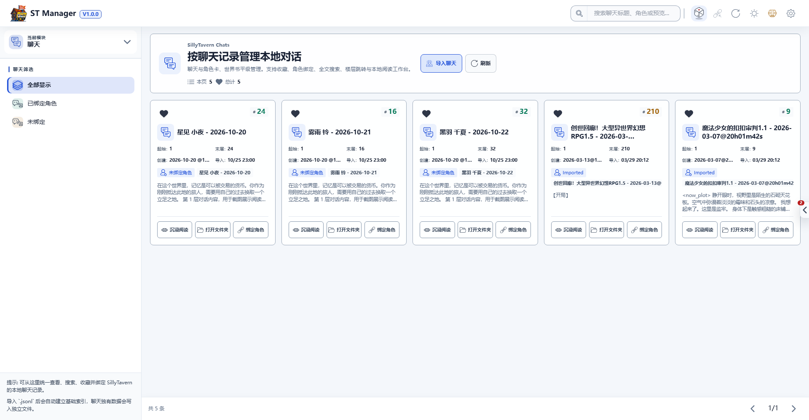
</p>

聊天工作区读取 JSONL 对话文件，按已绑定角色卡、未绑定记录和目录组织内容。列表显示消息数量、起止楼层、导入时间和角色信息，支持导入、搜索、修改元数据、绑定角色卡和移入回收站。

#### 8. 聊天阅读器

<p align="center">
  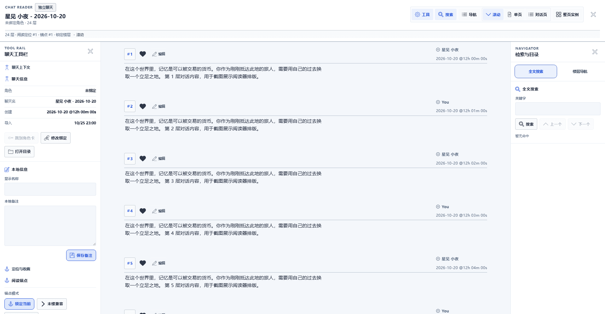
</p>

阅读器提供楼层导航、搜索、书签、锁定阅读位置、分页加载、前后页切换、实例/编辑入口和本地备注。对带有自定义 HTML/CSS 的聊天内容，会在隔离的阅读区域中呈现，便于长对话回看。

#### 9. 预设浏览

<p align="center">
  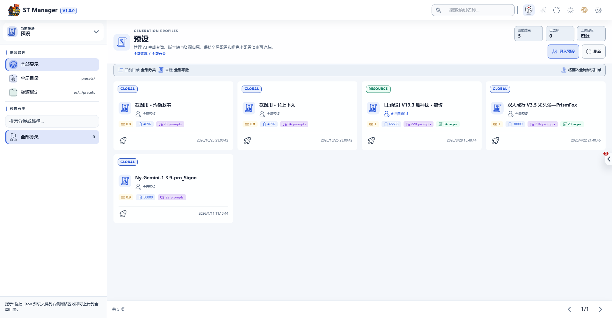
</p>

预设列表展示预设来源、版本、Token 上限、提示词数量和 Regex 数量，支持全局预设、资源绑定预设、分类文件夹、上传、移动、重置、导出以及发送到 SillyTavern。

#### 10. 预设编辑器

<p align="center">
  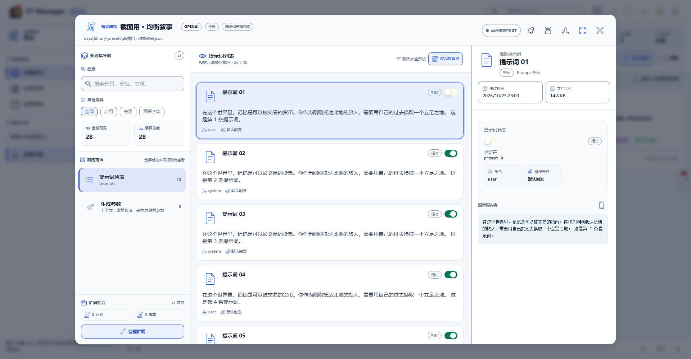
</p>

编辑器支持采样参数、模板、提示词上下文序列、系统消息、Chat Examples、Chat History、World Info 前后插入、开关状态和高级脚本等内容。修改可以保存为预设版本，并配合快照、版本导入、合并和默认版本管理。

#### 11. Beautify 美化包与主题

<p align="center">
  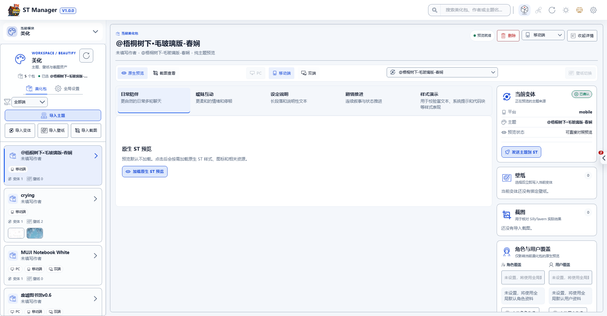
</p>

Beautify 工作区用于管理主题包的身份信息、包头像、PC/移动端变体、主题设置、局部壁纸、全局壁纸、全局头像和截图。每个包可以独立预览资源，修改后再发送到 SillyTavern，避免直接覆盖原始主题文件。

#### 12. 高级扩展：Regex 与 ST Helper

<p align="center">
  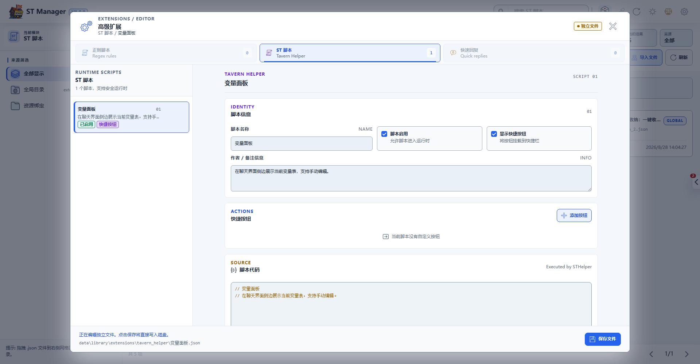
</p>

高级扩展编辑器包含 Regex 和 ST Helper 两类脚本，支持查找、替换、删除字符串、大小写、转义模式、作用位置、深度限制、启用开关和实时测试 playground。ST Helper 脚本同步会读取 JS-Slash-Runner 写入 ST `settings.json` 的全局脚本树，保留脚本文件夹、按钮、变量和导出选项，并导出为可再次导入插件的 JSON。

#### 13. 自动化规则工作台

<p align="center">
  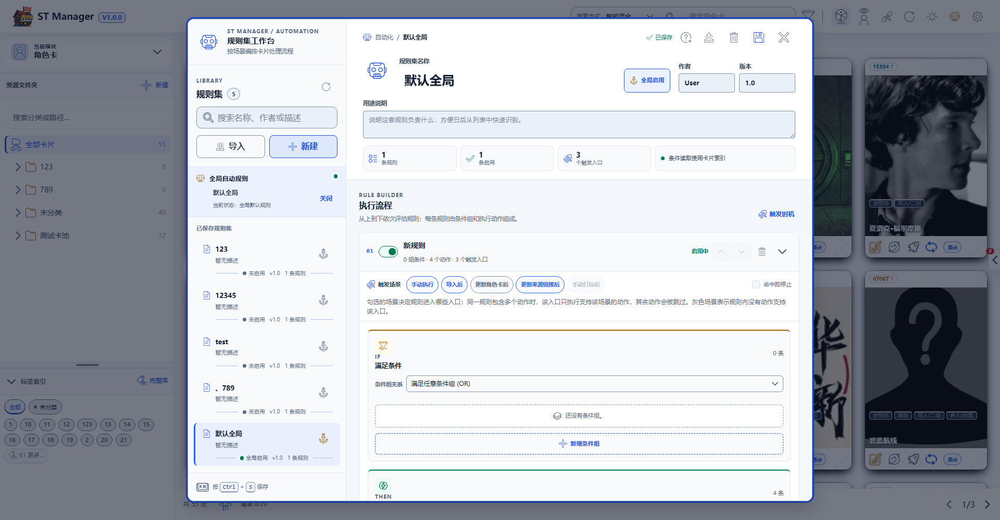
</p>

- 以 IF/THEN 方式组合条件组和动作。
- 条件支持 OR/AND、包含/不包含、多值匹配以及角色卡、世界书、脚本等目标字段。
- 动作支持添加、删除、重命名标签及其他批量资源操作。
- 支持规则集、全局规则、执行预览、规则导入导出和目标选择。
- 新增条件「Token 数（含未启用条目）」：把内嵌世界书的全部条目（含未启用）计入总量，与只统计启用条目的旧口径并列可选。
- 新增动作「替换文本」：支持字面量与正则、反向引用、区分大小写、仅替换首次，覆盖 14 个目标字段，只在手动执行时开放。

#### 14. 系统设置

<p align="center">
  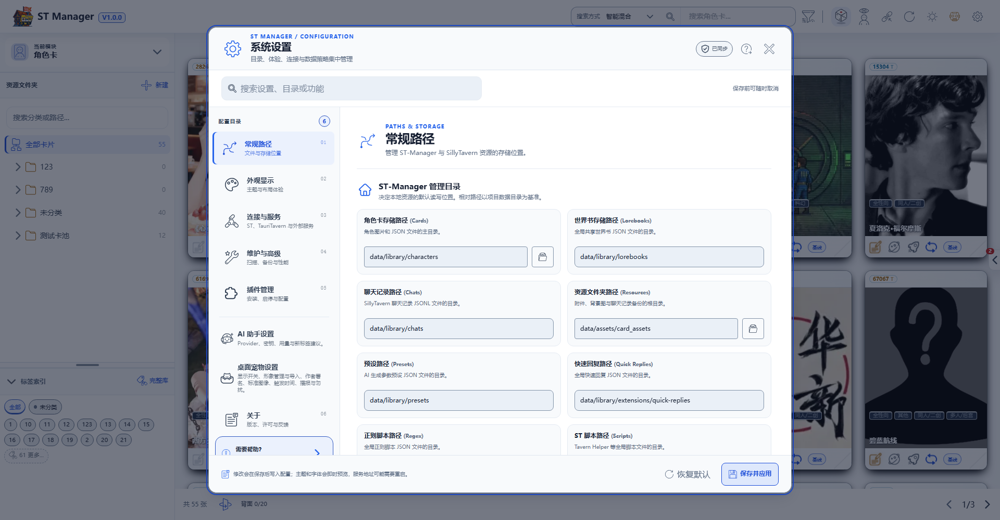
</p>

设置页覆盖常规路径、外观显示、连接与服务、维护与高级、插件管理、关于六类内容，包括角色卡/世界书/聊天/预设目录、SillyTavern 地址和认证、代理、深色模式、强调色、字体、卡片尺寸、壁纸、分页、自动保存、自动扫描和索引开关。插件目录、配置与密钥不写进 `config.json`，分别位于 `data/plugins/` 与 `data/system/secrets.json`。

#### 15. 插件管理

<p align="center">
  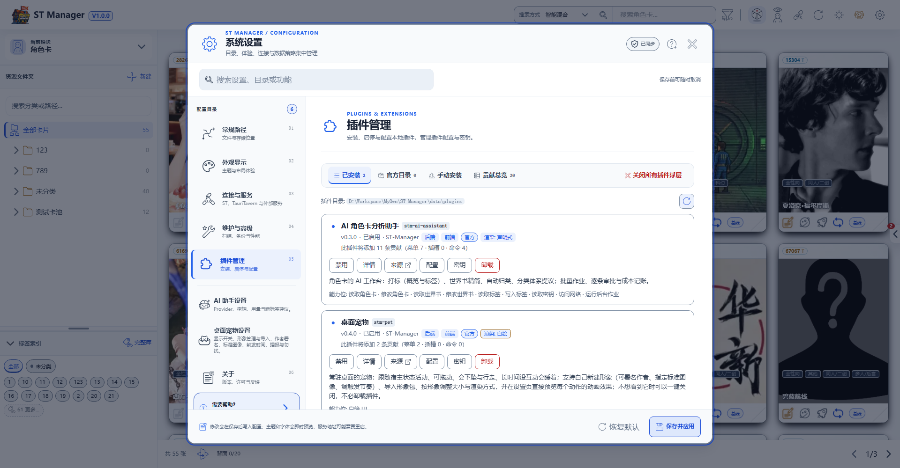
</p>

插件管理是设置页的第五个导航页，包含「已安装」「官方目录」「手动安装」「贡献总览」四个页签，右上角另有「关闭所有插件浮层」的兜底开关。

- **已安装**：查看版本、作者、归属分级与渲染方式，支持启用/禁用、详情（README 与 CHANGELOG 预览）、跳转安装来源、配置表单、密钥管理和卸载。
- **官方目录**：随包分发一份兜底清单，联网时优先拉取远端清单；一键安装或更新，卡片上显示可更新版本。内置官方插件为「AI 角色卡分析助手」与「桌面宠物」。
- **手动安装**：上传 zip，或填写 GitHub 仓库地址安装。
- **贡献总览**：按插件分组折叠，查看每个插件声明了哪些菜单、插槽与命令，可搜索并一键全部展开/折叠。
- 后端插件改动需要重启应用生效，界面会明确提示哪些操作需要重启。

<p align="center">
  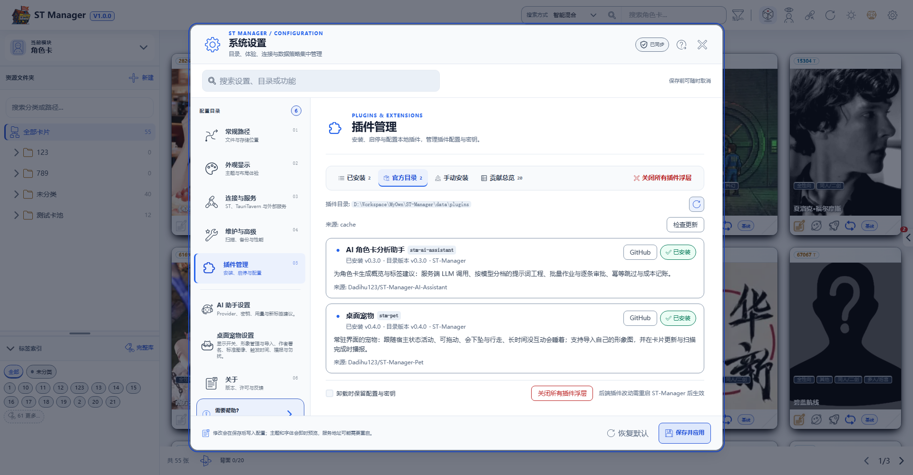
</p>

#### 16. 插件入口坞与贡献

<p align="center">
  
</p>

插件声明的入口会按落点出现在不同位置，无需为每个插件记住位置：

- 右侧入口坞：收起时只有一枚玻璃箭头，悬停或点击向左展开；容量上限为全局 8 个、单插件 2 个，超出部分进「更多」浮层（可搜索、按插件分组）。
- 右键菜单与批量操作菜单（同名入口可折叠成二级菜单）。
- 顶部动作区、设置页导航、卡片详情页签、页面工具条与空状态等插槽位置。
- 自绘界面的插件可以注册自己的浮层，卡住时用「关闭所有插件浮层」兜底。

<p align="center">
  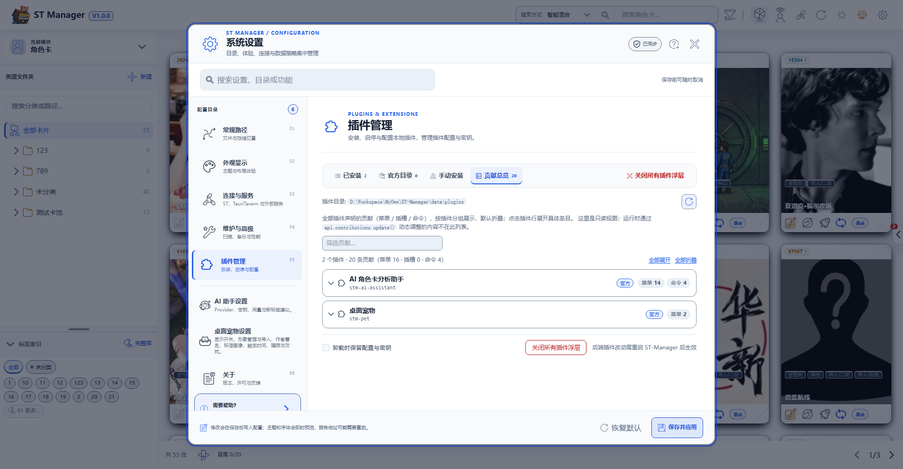
</p>

#### 17. 插件作业面板

<p align="center">
  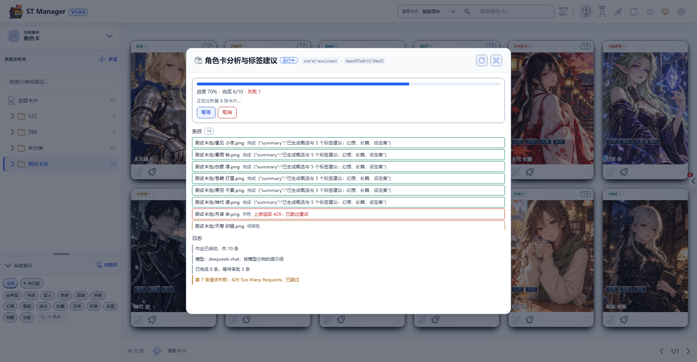
</p>

插件可以把自己的批量任务放到统一作业面板：显示进度百分比、完成/失败/跳过计数、逐条结果与日志，支持暂停、恢复、取消、只重跑失败项或全部重跑。需要人工确认的任务会逐条挂起等待审批，审批结果再继续执行。

#### 18. 抽卡

<p align="center">
  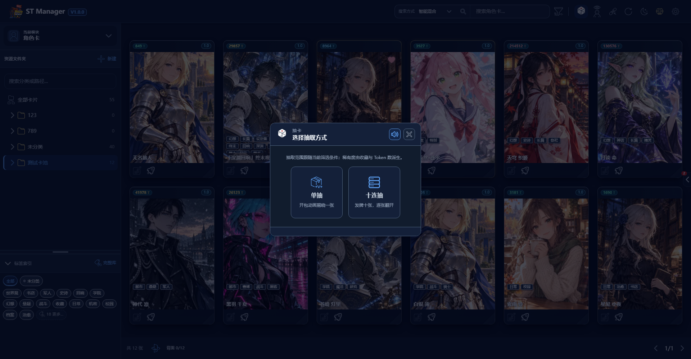
</p>

角色卡视图下的骰子按钮不再直接返回一张随机卡，而是打开抽卡弹窗：

- 起手两个大按钮：单抽（开包动画，可选划开封条 / 长按蓄力 / 转盘选包）与十连（发牌后逐张翻开，支持拖拽横扫批量翻牌）。
- 稀有度由现有数据派生：收藏 → UR；其余按 Token 分档（>100000 → SSR，>20000 → SR，>5000 → R，其余 N）。卡背默认完全一致，悬浮或聚焦才按稀有度显影。
- 十连默认带保底（至少一张 SR 及以上），卡池不足 10 张时有放回抽取并标记重复。
- 抽取沿用当前列表的筛选条件，不会抽到视图里看不见的卡；揭晓的是完整角色卡，点击可直接进入详情页。
- 音效默认开启，可随时静音，开关状态记在浏览器本地。

<p align="center">
  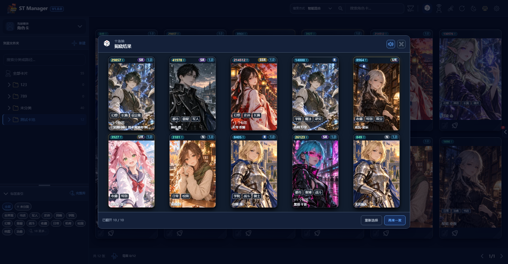
</p>

#### 19. 命令面板

<p align="center">
  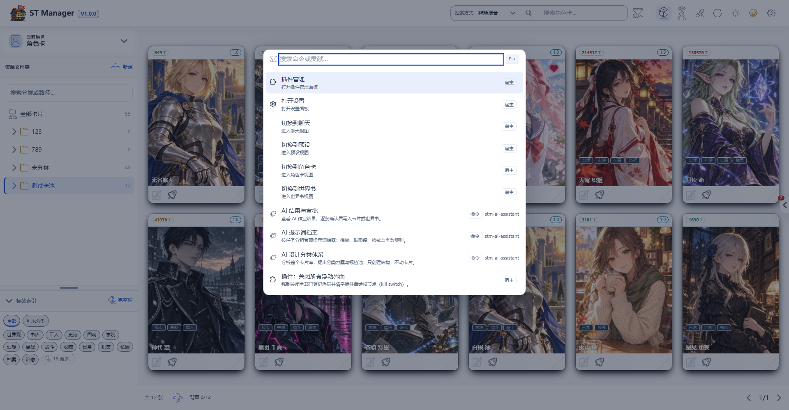
</p>

按 `Ctrl/Cmd + K` 打开命令面板，可搜索宿主内置动作（打开设置、插件管理、关于、切换工作区）、插件命令与插件投放的面板条目。每行标明来源与类型，当前不可用的命令会置灰并给出原因，而不是直接消失。插件声明的快捷键是全局的，按键时即时判断条件。

移动端没有硬件键盘，顶栏菜单里提供了「命令」按钮作为触屏入口，唤出的是同一个面板。

#### 20. 设置「关于」与世界书更新

<p align="center">
  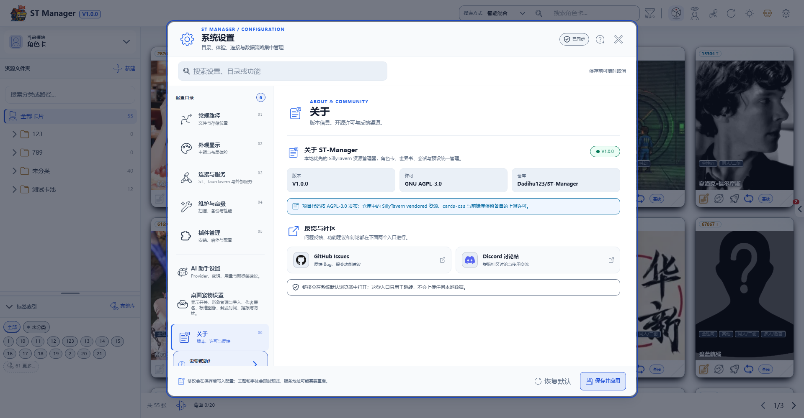
</p>

设置页第六个导航页「关于」显示当前版本（与页头徽标同源）、AGPL-3.0 许可与仓库地址，并提供 GitHub Issues 与 Discord 讨论帖两个外链入口。

<p align="center">
  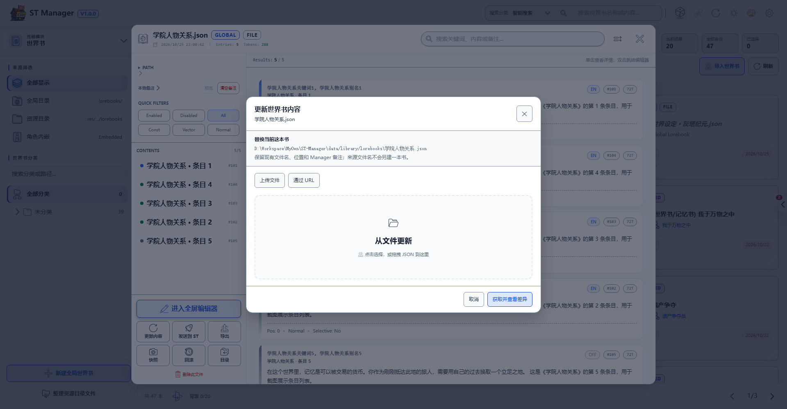
</p>

独立世界书详情底部新增「更新内容」：上传本地 JSON 或填写 http(s) 地址，先看红绿差异预览（条目与正文 / 完整 JSON 两种视图），确认后才整本替换。文件名、位置与 Manager 备注保留，写盘前自动备份并可从「回滚」恢复；预览后文件被外部改动会拒绝提交并要求重新比较。

#### 21. 后台索引重建

<p align="center">
  
</p>

索引升级不再阻塞启动：加载遮罩只覆盖建库、迁移、缓存等快阶段，重建移到后台线程，顶栏状态条显示阶段文案、百分比、已完成/总数与队列长度；完成后自动刷新列表并提示一次。重建期间列表走磁盘回退路径或旧索引，可以正常使用。

### 移动端

#### 1. 工作区总览与资源导航

<p align="center">
  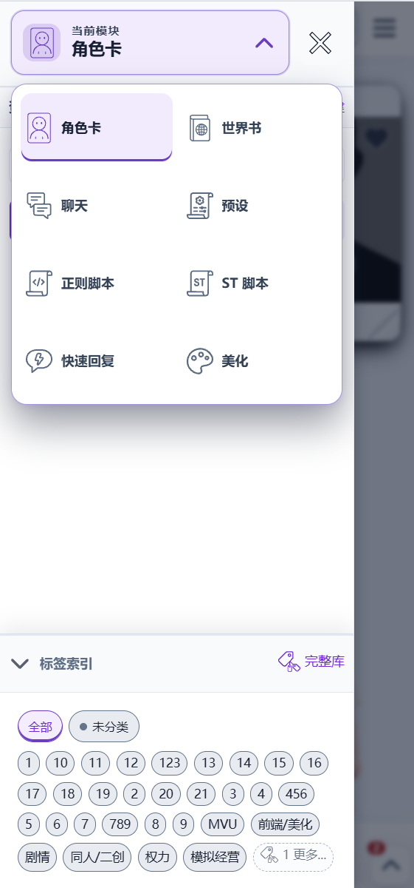
</p>

移动端将工作区标签、搜索、导入和侧边栏折叠到窄屏顶部，侧边栏展开后仍可在角色卡、世界书、聊天、预设、Regex 和 ST 脚本之间切换。

#### 2. 角色卡列表

<p align="center">
  
</p>

角色卡列表保留搜索、收藏、分页、卡片网格和快速编辑入口，并通过两列卡片布局适配手机宽度。

#### 3. 角色卡详情页与编辑工作台

<p align="center">
  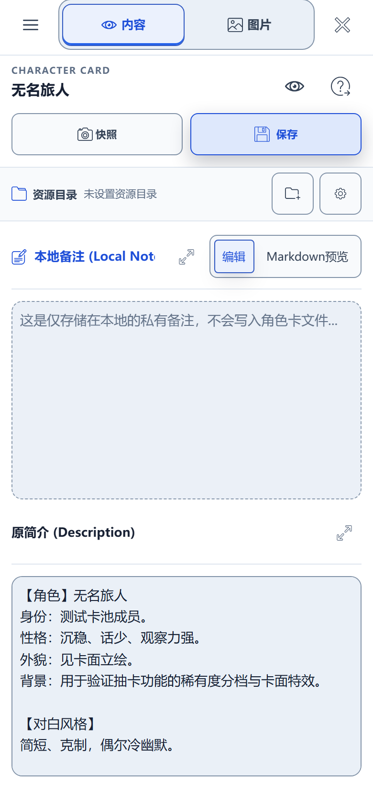
</p>

详情页将图片工具栏、面板导航、本地备注、描述和其他字段纵向排列；图片缩放、保存、标签、世界书、聊天、管理和资源入口仍然与 PC 端保持对应。

#### 4. 搜索、筛选与标签工作台

<p align="center">
  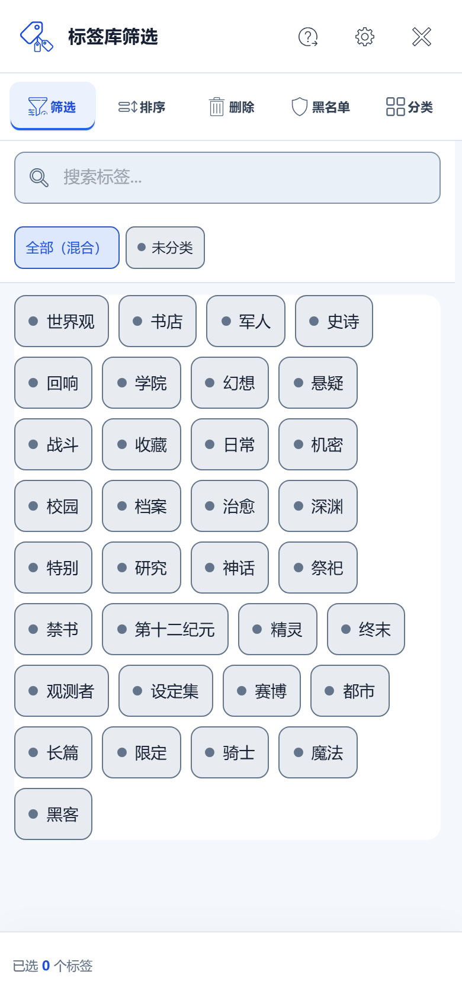
</p>

<p align="center">
  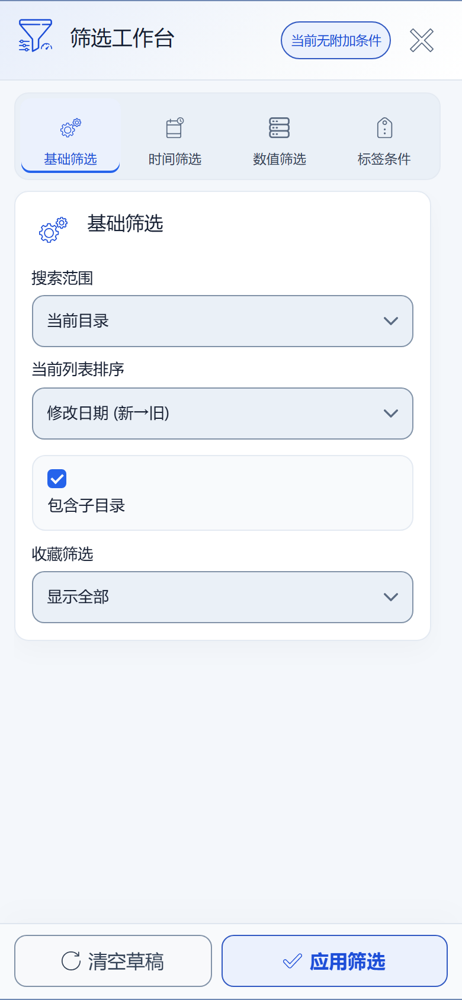
</p>

移动端会把桌面端的顶部筛选控件收纳为抽屉或弹层，保留搜索范围、标签包含/排除、收藏、Token 和日期筛选；标签编辑、颜色和批量操作在窄屏下改为纵向表单。

#### 5. 世界书浏览

<p align="center">
  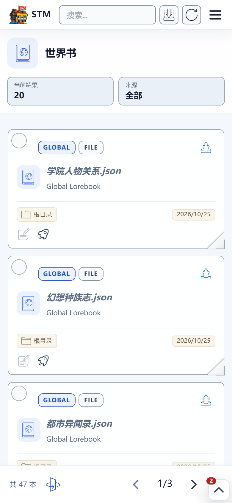
</p>

移动端世界书浏览保留全局、资源绑定和内嵌来源切换，列表卡片显示名称、来源和更新时间，详情入口进入同一世界书阅读/编辑工作流。

#### 6. 世界书编辑器与阅览

<p align="center">
  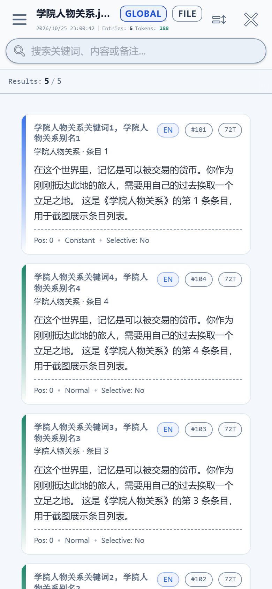
</p>

编辑器将条目内容、关键词、策略、递归和高级设置组织为可滚动区域，并保留保存、导出、历史、剪贴板、条目搜索和前后条目导航。

#### 7. 聊天记录管理

<p align="center">
  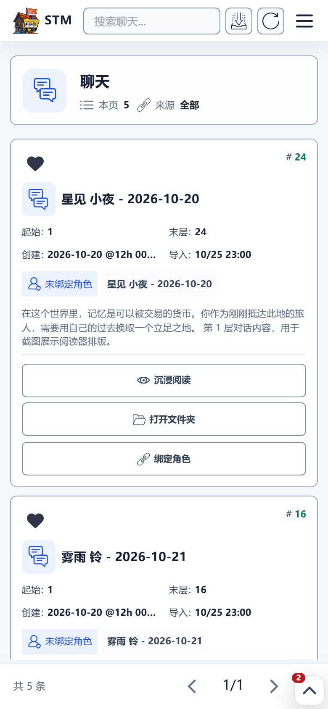
</p>

移动端聊天列表沿用已绑定/未绑定分类、消息数量、导入和搜索能力；较宽的元数据显示为可折叠详情，避免占用列表主区域。

#### 8. 聊天阅读器

<p align="center">
  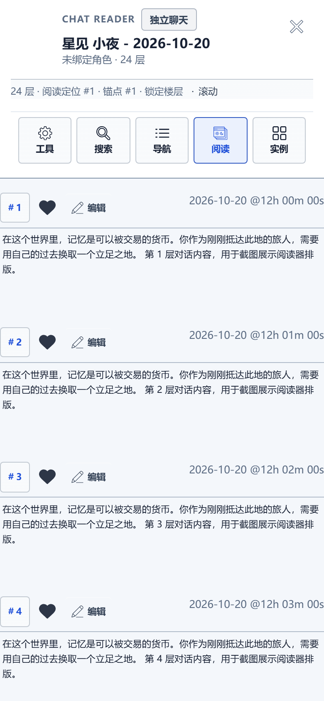
</p>

阅读器在手机上将工具、搜索、导航、整页实例和阅读模式集中到顶部操作区，楼层分页和锁定阅读位置独立呈现，正文区域保持连续滚动。

#### 9. 预设浏览

<p align="center">
  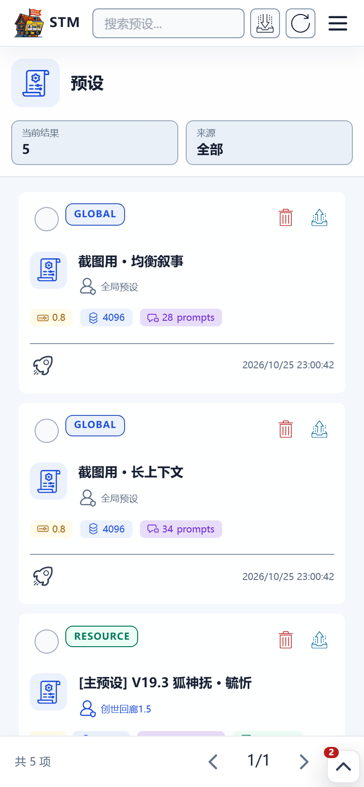
</p>

移动端预设浏览保留预设来源、版本、Token、提示词和 Regex 统计，并将分类、上传、导出和发送到 ST 收纳到顶部菜单或抽屉。

#### 10. 预设编辑器

<p align="center">
  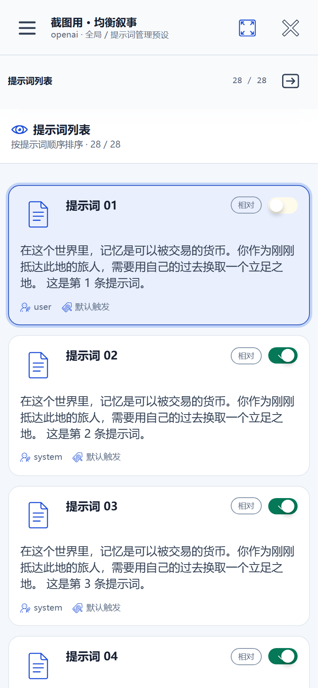
</p>

预设编辑器在移动端将采样参数、提示词块、系统消息和脚本区块纵向排列，提示词开关、排序、版本保存和恢复功能保持与 PC 端一致。

#### 11. Beautify 美化包与主题

<p align="center">
  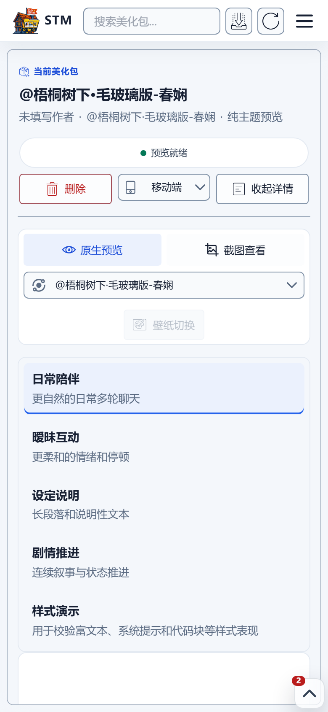
</p>

移动端 Beautify 工作区重点呈现移动端变体、壁纸、头像、主题设置和预览结果；PC/移动端变体仍由同一个主题包统一管理。

#### 12. 高级扩展：Regex 与 ST Helper

<p align="center">
  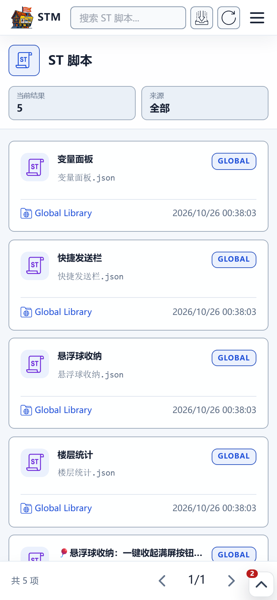
</p>

脚本编辑器在手机上将查找、替换、删除、作用位置、深度和 playground 改为纵向布局，保存和完成操作固定在易于触达的位置。

#### 13. 自动化规则工作台

<p align="center">
  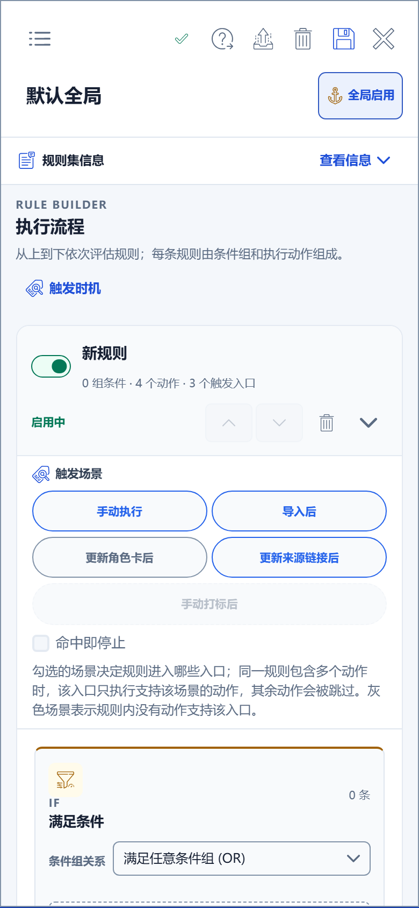
</p>

移动端规则编辑器将规则集列表、条件组和 THEN 动作拆分为可折叠区块，保留规则启用、排序、全局规则、执行和导入导出。

#### 14. 系统设置

<p align="center">
  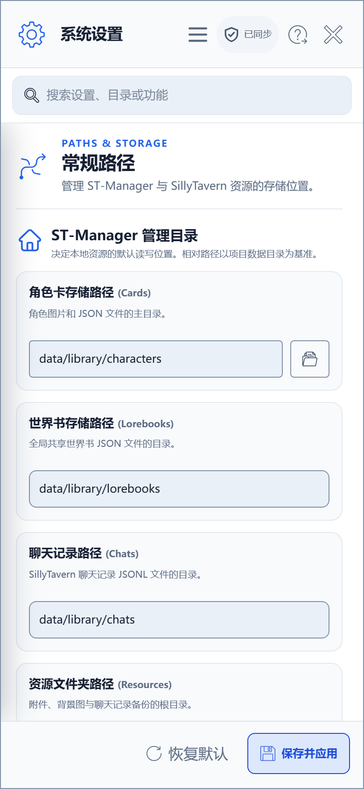
</p>

设置页在手机上改为「内容全宽 + 左侧抽屉导航」：标题栏左侧的菜单按钮唤出分区列表，抽屉里的按钮沿用 PC 端的样式（图标、标题、副标题与序号都在），点选分区后自动收起。设置内容本身不再被导航挤占，纵向表单占满整屏。

<p align="center">
  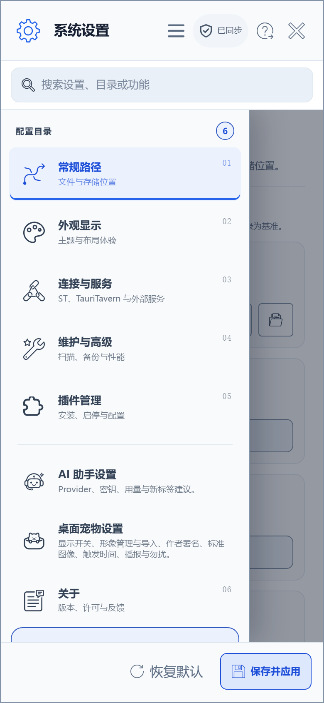
</p>

#### 15. 插件管理

<p align="center">
  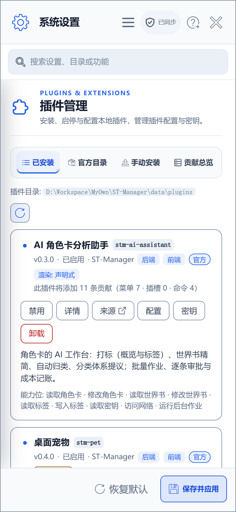
</p>

插件管理页在窄屏下把四个页签压成可横向滚动的标签栏，插件卡片改为纵向堆叠；配置、密钥与文档预览都走同一个全屏阅读层。

#### 16. 插件入口

<p align="center">
  
</p>

窄屏下右侧入口坞退化为贴在底部翻页栏上的向上箭头（带入口数量徽标），点开是底部 sheet；顶部动作区的插件入口折叠进「更多」。

#### 17. 插件作业面板

作业面板与桌面端使用同一个浮层组件，窄屏下随视口收缩，进度、计数、条目与日志改为纵向排列，状态与操作语义保持一致。

#### 18. 抽卡

<p align="center">
  
</p>

手机上的抽卡弹窗把十连结果改为全屏可滚动翻牌区（窄屏为三列），单抽开包动画等比缩放；揭晓卡与 PC 端一致，点击进入详情页。

#### 19. 命令面板

<p align="center">
  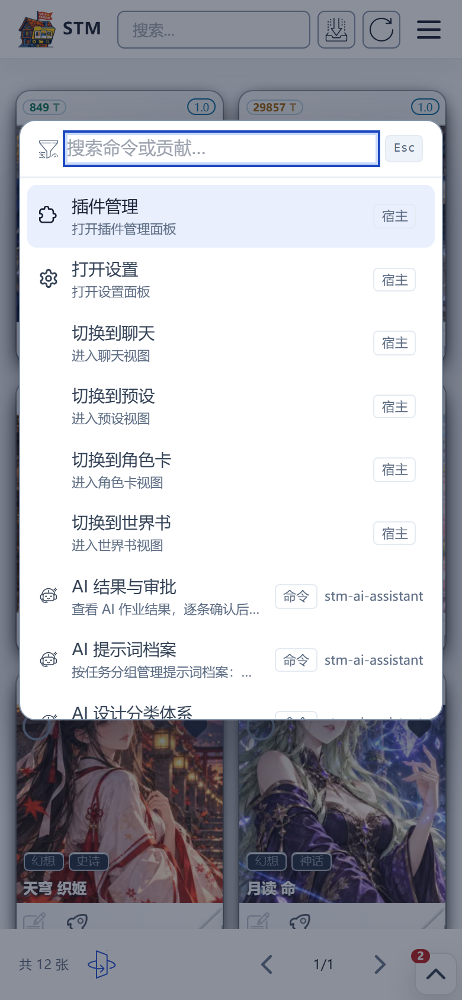
</p>

手机上没有 `Ctrl/Cmd + K`，因此顶栏菜单里有一个「命令」按钮：点开即弹出命令面板，内容与桌面端一致（宿主动作 + 插件命令）。面板宽度为 `min(640px, 92vw)`，搜索框与结果列表保持单列。

<p align="center">
  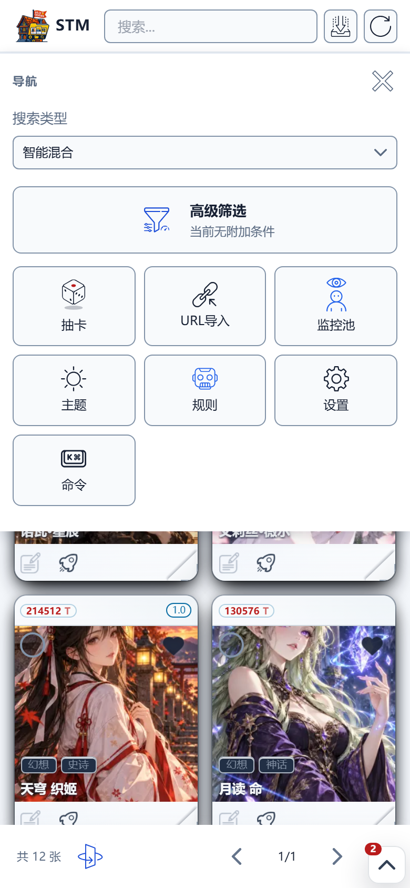
</p>

顶栏菜单把抽卡、URL 导入、监控池、主题、规则、设置与「命令」收进同一块面板，窄屏下不再需要常驻工具栏。

#### 20. 设置「关于」与世界书更新

<p align="center">
  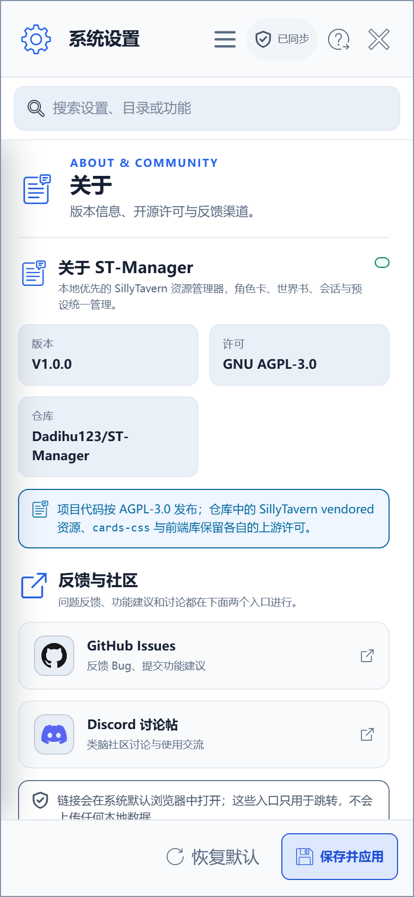
</p>

关于页在手机上纵向堆叠：版本、许可、仓库各占一行，两个外链入口改为整宽卡片。

<p align="center">
  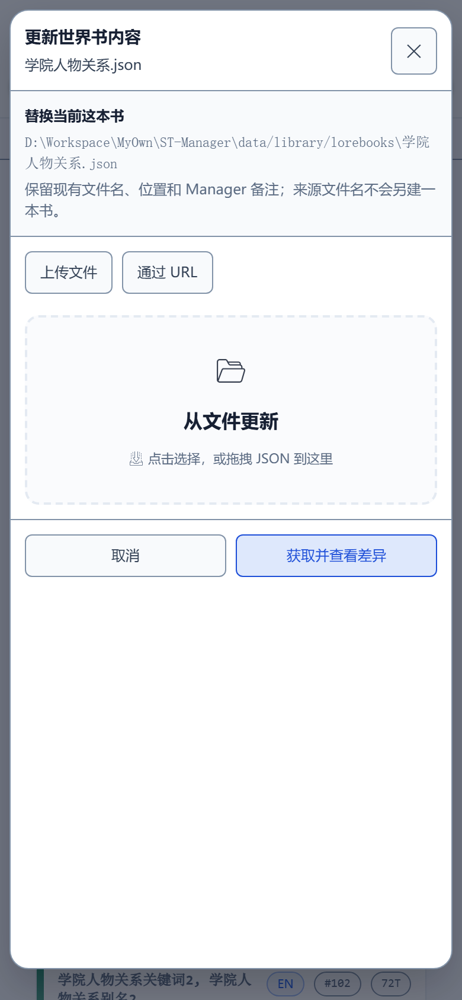
</p>

世界书更新预览在手机上以接近全屏的差异面板呈现，条目与正文 / 完整 JSON 的切换固定在顶部。

#### 21. 后台索引重建

索引状态条在窄屏下单独占一行，显示阶段文案与百分比进度，不挤压顶栏的其它控件；重建完成后列表自动刷新，无需手动操作。

## 快捷键

| 快捷键 | 作用 |
| --- | --- |
| `Ctrl/Cmd + K` | 打开或关闭命令面板（移动端用顶栏菜单的「命令」按钮） |
| `Esc` | 关闭当前浮层、命令面板、设置抽屉或二级菜单 |
| 插件声明的快捷键 | 由插件在清单里声明，全局生效；条件不满足时给出提示而不是静默失败 |

## 技术特点

- 后端：Python 3.10+、Flask、SQLite。
- 文件处理：Pillow、requests、watchdog。
- 前端：服务端模板、Alpine.js、ES modules、Tailwind CSS，以及本地 Markdown/HTML 清理和差异查看库；插件宿主由贡献注册表与多层挂载容器组成。
- 数据策略：资源文件保存在可配置目录，SQLite 保存元数据、索引和 UI 关联数据；写入操作配合重试、WAL 和路径边界检查。
- 插件系统：插件契约 v3（`manifest_version` / `api_version` = 3），支持声明式贡献（菜单树、插槽、命令）与自绘界面两种模式；插件可写后端 Python，前端 API 与清单 schema 均由代码生成，随包提供独立校验器供第三方插件自检。
- 部署方式：本地 Python、Docker Compose，桌面端通过 PyInstaller 工作流构建。

## 快速开始

### 本地 Python

```bash
python -m venv .venv

# Windows PowerShell
.\\.venv\\Scripts\\Activate.ps1

# macOS / Linux
# source .venv/bin/activate

pip install -r requirements.txt
python app.py
```

默认访问地址是 `http://127.0.0.1:5000`。首次启动会生成 `config.json` 使用的运行目录和 `data/system/db/cards_metadata.db`。配置文件与运行数据不应提交到公开仓库。

可以通过命令行覆盖监听参数：

```bash
python app.py --host 127.0.0.1 --port 5000
python app.py --debug
```

### Docker Compose

```bash
docker compose up --build
```

Compose 将 `./data` 挂载到容器的 `/app/data`，将 `./config.json` 挂载到 `/app/config.json`，服务默认暴露在 `http://127.0.0.1:5000`。

## 文档

- [API 参考](docs/API.md)：业务接口、请求方式、参数和文件资源端点，含插件系统接口与错误码。
- [配置参考](docs/CONFIG.md)：`config.json` 全部配置项、默认值、插件目录设置与安全注意事项。
- [开发指南](docs/DEVELOPMENT.md)：项目结构、启动链路、测试、CSS 构建和打包。
- [插件 API 参考](docs/plugin-api.md)：插件后端与前端 API 的完整参考（由代码生成）。
- [插件清单 schema](docs/plugin-manifest.schema.json) / [类型定义](docs/plugin-api.d.ts)：`manifest.json` 校验与编辑器补全。
- [插件 v2 → v3 迁移](docs/plugin-migration-v2-to-v3.md)：旧契约升级说明。
- [SVG 图标系统](docs/svg-icon-system.md)：网页模板图标精灵的组织与使用约定。

## 反馈与贡献

欢迎通过 Issue 反馈问题或提出建议：

- [GitHub Issues](https://github.com/Dadihu123/ST-Manager/issues)
- [Discord 讨论帖](https://discord.com/channels/1134557553011998840/1448353646596325578)

## 许可证

项目代码按 [GNU AGPL-3.0](LICENSE) 发布。仓库中的 SillyTavern vendored 资源、`cards-css` 和前端库保留各自的上游许可与版权声明；抽卡功能额外引入了 `pack-opener`（MIT，音效为 CC0）与 `pokemon-cards-css`（GPL-3.0，作用域已收窄到抽卡揭晓卡），分发时请同时遵守对应目录中的 notice 文件。
